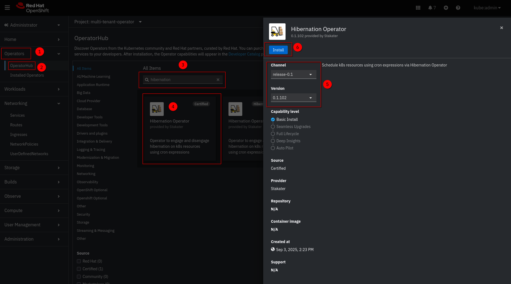
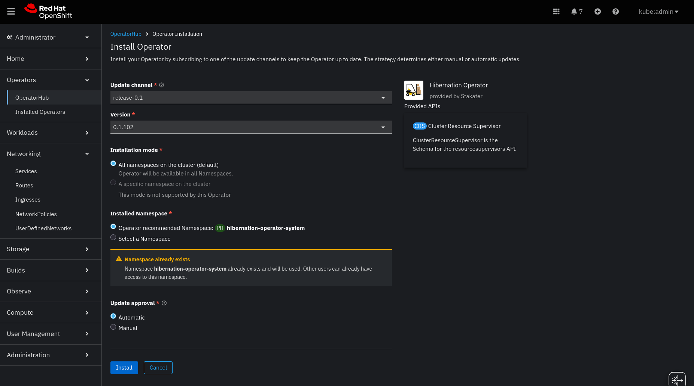
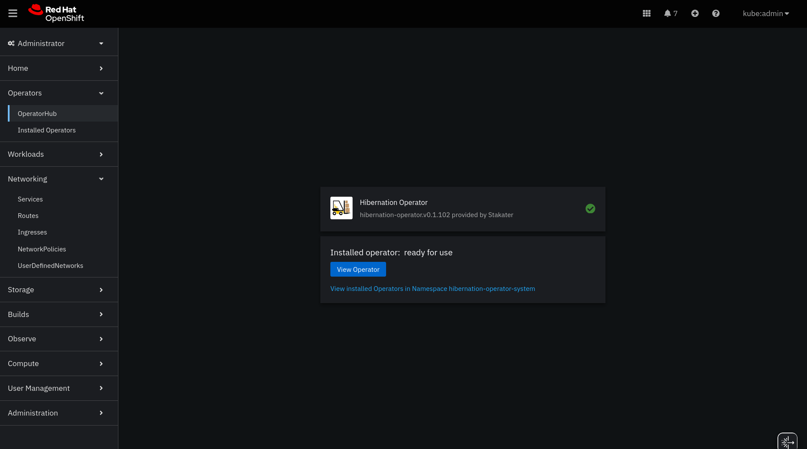
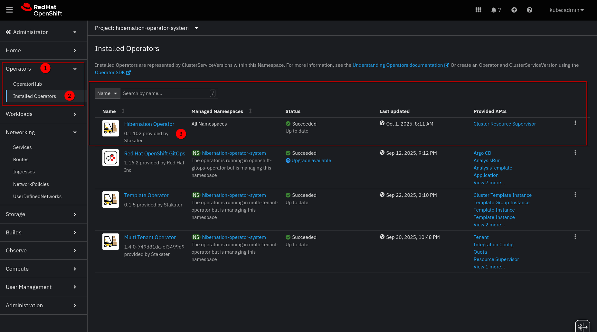

# On OpenShift

The **Hibernation Operator** is a [Red Hat Certified Operator](https://catalog.redhat.com/en/software/container-stacks/detail/687efb0f70dee945827cfe24) available on the **Red Hat Marketplace** and **OperatorHub** in OpenShift.

This page describes how to install the Hibernation Operator on OpenShift, either through the OperatorHub UI or declaratively with the CLI. To remove the operator, refer to [Uninstalling](../uninstalling.md).

## Requirements

* An **OpenShift** cluster (v4.10 or higher recommended)

cert-manager is not required on OpenShift. OLM manages the certificate for the validating admission webhook itself.

---

## Installing via OperatorHub UI

1. In the OpenShift Console, navigate to **Operators → OperatorHub** from the left sidebar.
1. Search for **`Hibernation Operator`** and click on the tile.
1. Click the **Install** button.

   

1. Configure the installation:
   * **Update channel**: `release-0.1`
   * **Installed Namespace**: Select **`hibernation-operator-system`** (create if it doesn’t exist)
   * **Update approval**:  
       * `Automatic` for development  
       * `Manual` for production (allows review of upgrades)

   Click **Install**.

   

1. Wait for the operator to install. You’ll see a status of **Installed operator: Ready for use** when ready.
1. Once installed, the Hibernation Operator is ready to manage hibernation policies across your cluster.

   

> **Note**: The operator is installed in the `hibernation-operator-system` namespace by default.

---

## Installing via CLI or GitOps

Use this method for automation, CI/CD pipelines, or GitOps workflows (e.g., with ArgoCD).

### Step 1: Create the Operator Namespace

```bash
oc create namespace hibernation-operator-system
```

### Step 2: Create an OperatorGroup

```bash
oc create -f - << EOF
apiVersion: operators.coreos.com/v1
kind: OperatorGroup
metadata:
  name: hibernation-operator
  namespace: hibernation-operator-system
spec: {}
EOF
```

### Step 3: Create a Subscription

```bash
oc create -f - << EOF
apiVersion: operators.coreos.com/v1alpha1
kind: Subscription
metadata:
  name: hibernation-operator
  namespace: hibernation-operator-system
spec:
  channel: release-0.1
  installPlanApproval: Automatic
  name: hibernation-operator
  source: certified-operators
  sourceNamespace: openshift-marketplace
  # Optional: pin to a specific version
  # startingCSV: hibernation-operator.v0.1.102
EOF
```

> **GitOps Tip**: Commit these YAMLs to your GitOps repo to manage the operator declaratively.

### Step 4: Verify Installation

In the OpenShift Console:

* Go to **Operators → Installed Operators**
* Select the `hibernation-operator-system` project
* Confirm the **Hibernation Operator** status is **Succeeded**

Or via CLI:

```bash
oc get csv -n hibernation-operator-system
oc get pods -n hibernation-operator-system
```

Wait until the `hibernation-operator-controller-manager` and `hibernation-operator-webhook` pods are `Running`.



---

## Notes

* It integrates natively with **OpenShift workloads** (`Deployments`, `StatefulSets`) and **ArgoCD** (if installed).
* For production, use **Manual approval** and test upgrades in a staging cluster first.
* Full CRD documentation:
    * [`ClusterResourceSupervisor`](../../concepts/cluster-resource-supervisor.md)
    * [`ResourceSupervisor`](../../concepts/resource-supervisor.md)
    * [API Reference](../../reference/api.md) — generated field reference
