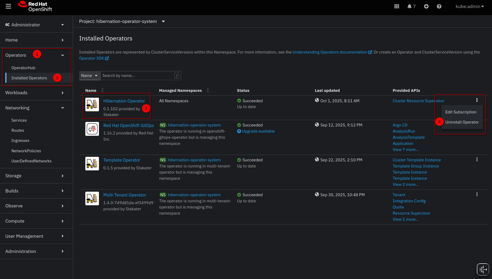

# Uninstalling

The Hibernation Operator must remove its custom resources before the operator itself is removed. Each `ResourceSupervisor` and `ClusterResourceSupervisor` carries a finalizer, and the operator handles that finalizer by restoring every workload the resource put to sleep and, for a `ClusterResourceSupervisor`, by clearing the ArgoCD sync windows it wrote. If the operator is removed first, nothing remains to process the finalizers: the deletion of the resources does not complete, and the hibernated workloads remain at zero replicas.

Uninstall in the following order.

## 1. Delete the custom resources

While the operator is still running, delete every supervisor:

```sh
kubectl delete clusterresourcesupervisors.hibernation.stakater.com --all
kubectl delete resourcesupervisors.hibernation.stakater.com --all --all-namespaces
```

Each deletion completes once the operator has restored the workloads of that resource. Confirm that none remain before continuing:

```sh
kubectl get clusterresourcesupervisors.hibernation.stakater.com
kubectl get resourcesupervisors.hibernation.stakater.com --all-namespaces
```

If a deletion does not complete, inspect the events on the resource with `kubectl describe`. A failed restoration is reported there as a `WakeFailed` event, and the finalizer is retained until the restoration succeeds.

## 2. Remove the operator

### Helm

```sh
helm uninstall hibernation-operator --namespace hibernation-operator-system
```

This removes the operator deployments, RBAC resources and services. Helm does not remove the CRDs, because the chart installs them from its `crds/` directory.

### OpenShift (OLM)

In the OpenShift web console:

1. Navigate to **Operators → Installed Operators** and select the `hibernation-operator-system` project.
1. Open the actions menu for **Hibernation Operator** and select **Uninstall Operator**.
1. Confirm the removal.

   

Alternatively, delete the `Subscription` and the `ClusterServiceVersion` with the CLI:

```sh
oc delete subscription hibernation-operator -n hibernation-operator-system
oc delete csv -n hibernation-operator-system \
  -l operators.coreos.com/hibernation-operator.hibernation-operator-system
```

OLM does not remove the CRDs either.

## 3. Remove the CRDs and the namespace

Once no custom resources remain, the CRDs and the operator namespace can be removed:

```sh
kubectl delete crd \
  resourcesupervisors.hibernation.stakater.com \
  clusterresourcesupervisors.hibernation.stakater.com
kubectl delete namespace hibernation-operator-system
```

## Recovering from an incorrect order

If the operator was removed while supervisors still existed, their deletion remains pending on the finalizer. The simplest recovery is to reinstall the operator, which then processes the pending deletions and restores the workloads.

If reinstalling is not possible, record the replica counts from `status.sleepingNamespaces` of each pending resource, scale the workloads back manually, and then remove the finalizer:

```sh
kubectl patch clusterresourcesupervisor <name> --type merge \
  -p '{"metadata":{"finalizers":null}}'
```

Removing the finalizer without first restoring the workloads discards the only record of their replica counts.
